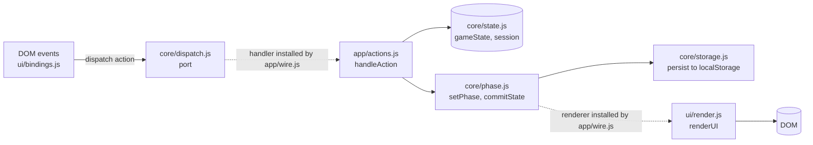

# Architecture

## Overview

A single-page app made of native ES modules. There is no bundler and no framework; `index.html` loads `js/main.js`, which imports everything else.

This is **step 1 of 4**: the shell. It has the infrastructure of the finished Spyfall app (state, phases, dispatch, storage, i18n, themes, service worker, tests) and two screens, `welcome` and `setup`, and **no game logic**. `game/` and `data/` are empty on purpose: step 2 puts the game's rules and data there.

## Shared infrastructure files

Mafia and Spyfall are meant to stay recognisably aligned: the same folders, the same file names for shared infrastructure, the same scripts and CI, the same coding style. A fix to one of these files is worth making in both repositories; do not reshape them here without a reason. This list was made by comparing the two trees file by file.

**Identical** (byte for byte the same as in Spyfall):

- Root and tooling: `.editorconfig`, `.gitattributes`, `.gitignore`, `.prettierrc.json`, `eslint.config.js`, `LICENSE`, `.github/dependabot.yml`, `.github/workflows/ci.yml`, `.github/workflows/deploy.yml` (both workflows are repository-name independent), `scripts/build.mjs`, `scripts/serve.mjs`.
- `assets/fonts/Vazirmatn-Variable.woff2` (the self-hosted font).
- `js/core/buildInfo.js` (the two stamped constants), `js/i18n/catalogs.js`, `js/platform/antiZoom.js`, `js/platform/install.js`, `js/platform/serviceWorker.js`, `js/platform/wakeLock.js`, `js/ui/buildInfoReveal.js`, `js/ui/feedback.js`, `js/ui/focusTrap.js`, `js/ui/langSwitch.js`, `js/utils/random.js`.
- Tests and helpers: `tests/unit/build-info-reveal.test.mjs`, `tests/unit/preinit.test.mjs`, `tests/unit/random.test.mjs`, `tests/unit/helpers/cssTokens.mjs`, `tests/unit/helpers/htmlScan.mjs`.

**Near-identical** (the same code; only the name of the app, the storage-key prefix, or what Mafia does not have differs):

- `sw.js` (`CACHE_PREFIX = 'mafia-'`, comments), `js/preinit.js` (`mafia_lang`), `js/i18n/index.js` (`LANG_STORAGE_KEY`), `js/platform/installHint.js` (the dismissal key), `js/ui/buildInfo.js` (a comment), `js/ui/theme.js` (the theme key is an exported constant), `js/core/phase.js`, `js/core/dispatch.js` (without `showInfoModal`, which is Spyfall's help text), `js/core/storage.js` (the save key and no Spyfall setup, words or names), `js/core/state.js` (a smaller state), `js/app/wire.js` (without the timer hook), `js/utils/text.js` (without the deprecated `formatSecondsFa`), `manifest.json`, `package.json` (name, version, repository), `.prettierignore`.
- `css/style.css`, assembled from the shared part of Spyfall's stylesheet: tokens, the eight themes, base, buttons, inputs, modal, toast, install button and hint, language switch, play button, title and build line, utility classes. Component rules that only Spyfall's screens use were left out.
- The infrastructure tests, ported with the names and keys changed: `import-cycles`, `i18n`, `i18n-direction`, `i18n-en`, `i18n-format`, `i18n-html`, `i18n-list`, `no-hardcoded-text`, `html`, `css-direction`, `theme-colors`, `build-info`, `build-stamp`, `install-hint`, `text`, `config`, `phase`, `lang-switch` (rewritten for the smaller set of phases) and `helpers/fakeEnv.mjs`, `helpers/harness.mjs`. In `tests/e2e/`: `build-info`, `build-info-reveal`, `install-hint`, `first-paint`, `theme-colors`, `lang-switch`, `smoke`, and the helpers `app.mjs`, `longPress.mjs`, `record.mjs`, `themeProbe.mjs`, `fixtures/make-persian-baseline.mjs`.

**Adapted** (the same job, different content): `index.html`, `js/main.js`, `js/app/actions.js`, `js/core/config.js`, `js/ui/bindings.js`, `js/ui/render.js`, `js/ui/setup.js`, `js/i18n/fa.js`, `js/i18n/en.js`, the icons, `README.md`, `CHANGELOG.md`, `CONTRIBUTING.md`.

## Mafia-specific files

**None yet.** Every source file of this version exists in Spyfall in some form. What Mafia adds in step 1 is tests only: `tests/unit/{bindings,lang-round-trip,modal,phase-flow,screens,storage-state,theme,theme-tokens}.test.mjs`, `tests/e2e/{confirm-modal,offline,players-count,theme-selector}.test.mjs`, `tests/unit/setup.test.mjs` (the players-count field) and the recorded `tests/e2e/fixtures/persian-baseline.json`. Files that belong to Mafia alone (its roles, phases, rules and data) are added in step 2 and listed here when they exist.

## Layering rules

The folders are layers, and `tests/unit/import-cycles.test.mjs` reads every `import` under `js/` and fails on a violation (it prints the path):

1. **No import cycles**, and no import of a file that does not exist.
2. **`core/` and `i18n/` never import from `game/`, `ui/` or `app/`.** What `core/` needs from above is injected at start-up through the seams below.
3. **`data/` imports only `data/`.** The language is passed in as an argument, never read from `i18n/`.
4. **`app/` is imported by `main.js` only** (`app/wire.js` installs `app/actions.js`; nothing else may import the handler).
5. `game/`, `ui/`, `platform/` and `utils/` may import `core/` and `i18n/`; `utils/` and `core/config.js` stay pure (no DOM), so they stay unit-testable.

`js/game/` and `js/data/` contain no files in this version, so rules 2 and 3 are proved on throwaway trees inside the test instead of on real files. The folders are kept in the repository (and in the zip) so the layout matches Spyfall's.

## Control flow

1. A DOM event calls `dispatch({ type, payload })`. `dispatch` lives in `core/dispatch.js` and only forwards to a handler.
2. The handler is `handleAction` in `app/actions.js` (a `switch`), installed by `wireApp()` from `main.js`. It mutates `gameState`, then calls `setPhase` or `commitState()`.
3. `commitState()` (in `core/phase.js`) calls the installed renderer, `renderUI()`, which shows the screen for `gameState.phase`, and then persists the state.

Dotted arrows are the injected links; everything else is a plain `import`. The seams are plain synchronous callbacks rather than events on purpose: calls stay re-entrant (an action can dispatch another action) and an exception still reaches the caller. An unconnected seam throws instead of doing nothing, so a forgotten `wireApp()` fails loudly.

| Seam | Lives in | Filled with | Why it is a seam |
| :--- | :--- | :--- | :--- |
| `dispatch(action)` | `core/dispatch.js` (`setDispatchHandler`) | `handleAction` from `app/actions.js` | The handler needs every module, and those modules need to dispatch. |
| `commitState()` renders | `core/phase.js` (`setRenderer`) | `renderUI` from `ui/render.js` | `commitState` and `setPhase` are called from many places, and rendering reads them. |
| `setPhase()` pre-hook | `core/phase.js` (`setBeforePhaseChange`) | nothing yet | A phase that owns something (a timer) must not outlive its screen: step 2 can use it, as Spyfall does. |

**Phases in this version:** `welcome → setup → welcome`. Adding a phase is an entry in `VALID_PHASES` (`core/config.js`), a `<section id="screen-<phase>" class="screen-view hidden">` in `index.html` and its drawing in `ui/render.js`. `renderUI` shows exactly the screen whose id is `screen-<phase>`, hides the others, and (when the phase changed) moves the focus to the new screen's heading. `NAVIGATE` ignores a phase that is not in `VALID_PHASES`.

## State model

| Object | Persisted | Purpose |
| :--- | :--- | :--- |
| `gameState` | once a game has players (never in this version) | Everything visible to the table: `version`, `stateVersion`, `phase`, `settings` (`playersCount`), `players`. |
| `session` | no | Ephemeral UI state: the callback of the confirm dialog's "yes" button. |

`gameState` is an exported `const` object. Restoring a save uses `replaceGameState()`, which swaps the contents **in place**, so every module keeps a valid reference. Saves are versioned (`SAVE_VERSION`) and `persist()` writes `{ version, state }` only when the game has players, so the welcome and setup screens save nothing; a reader must ignore a record of another version. Step 2 adds what a game needs (roles, secrets held by the moderator's device, rounds) and the code that reads a save back; its shape is not decided here.

### The players-count field

`ui/setup.js`. `parsePlayersCount(text)` turns the typed text into a number: Latin, Persian and Arabic-Indic digits are read, spaces and invisible direction marks around them are ignored, and anything else (a letter, a sign, a decimal point, an empty box) is `NaN`, a typo to point out rather than a number to guess at. `isValidPlayersCount(n)` is a whole number from `RULES.players.min` to `RULES.players.max` (3 to 20, `core/config.js`). `validateAndSaveSettings()` runs on the field's `change` event (`SET_PLAYERS_COUNT`): a good count is saved in `gameState.settings.playersCount` and written back in plain digits; a bad one leaves the saved count as it was, shows the language's message (`flagFieldError`: a toast, and the field is marked `aria-invalid`, pulsed and focused) and keeps what was typed so it can be corrected. The hint under the field (`updateSetupLimitHints`) states the same limits, written from `RULES`, so the numbers cannot differ from the rule.

## Modules

| Layer | Modules | Notes |
| :--- | :--- | :--- |
| `app/` | `actions`, `wire` | The action handler (the `switch`) and the composition root. Only `wire` imports `actions`, and only `main.js` imports `wire`. |
| `core/` | `config`, `state`, `storage`, `phase`, `dispatch`, `buildInfo` | `config` is pure data (the phases, the limits, the theme colours). `buildInfo` is two stamped constants (version, hash) and imports nothing. `dispatch` is a port and `phase` holds `setPhase` and `commitState`; neither imports `game/`, `ui/` or `app/`. |
| `game/` | (empty) | Step 2: the rules. |
| `ui/` | `render`, `setup`, `bindings`, `feedback`, `focusTrap`, `langSwitch`, `theme`, `buildInfo`, `buildInfoReveal` | All DOM code lives here. |
| `platform/` | `wakeLock`, `antiZoom`, `install`, `installHint`, `serviceWorker` | Browser capabilities. `installHint` is pure (no imports, no DOM): it decides which install hint applies (see [Install hint](#install-hint)). |
| `i18n/` | `index`, `catalogs`, `fa`, `en` | Translation core and the Persian and English catalogs (see [Translations](#translations)). |
| `js/` root | `main`, `preinit` | `main` is the module entry. `preinit` is a classic script loaded from `<head>` that is not part of the module graph (see [First paint in another language](#first-paint-in-another-language)). |
| `data/`, `utils/` | (`data/` empty), `text`, `random` | `utils/` is pure and unit-tested. |

## Translations

**Every text a player can see comes from `t(key)` (in JS) or from a `data-i18n` attribute (in `index.html`).** The catalogs in `js/i18n/` hold the texts; `fa.js` is the Persian one and the last fallback, `en.js` is the English one.

- **Catalog:** a flat object of dotted English keys grouped by screen (`setup.title`, `welcome.tagline`). Values are plain text with optional `{name}` parameters, never HTML. `catalogs.js` lists every catalog, and the tests walk that list. `en.js` carries a glossary: one English term per game idea, used everywhere; step 2 adds its terms there.
- **Tools.** `tn(key, count, params)` picks `key.one` / `key.other` by `Intl.PluralRules` of the active language and fills `{count}` with `formatNumber(count)`. `formatNumber(n)` writes the digits of the language (`NUMERALS`). `formatDuration(seconds)` uses `time.*`. `formatList(items)` writes "A, B and C" from `names.*` templates (catalog-driven on purpose, not `Intl.ListFormat`, so Persian stays exactly as it is). `setTemplate(element, key, slots, params)` writes one whole sentence into an element without `innerHTML`. `tHtml` / `tnHtml` do the same for an HTML string, escaping the catalog text and every parameter except one wrapped in `rawHtml()`.
- **No Persian in the code.** `tests/unit/no-hardcoded-text.test.mjs` fails on any Persian letter, digit or comment under `js/` except `i18n/` and a short, commented list of input-normalisation lines in `utils/text.js`.
- **`t(key, params)`** looks in the active language, then in Persian, then returns the key itself. It never interprets HTML and never escapes anything: put its result into `innerHTML` only after `escapeHtml`. `textContent` needs no escaping.
- **Static HTML keeps its Persian text.** The text written in `index.html` is the default, so the first paint, the offline path and the Persian experience never wait for JS. An element gets `data-i18n="key"` (leaf elements only) or `data-i18n-attr="aria-label:key;placeholder:key"`. `<title>` and `<meta name="description">` use the same attributes.
- **Start-up and switching.** `initI18n()` runs first in `main.js`: it reads the saved language (`mafia_lang`) and translates the static HTML only if that language is not the default. `setLang(lang)` ignores an unsupported language; otherwise it saves the choice, sets `<html lang dir>`, translates the static HTML (always, so going back to Persian works) and tells the `onLangChange` listeners.
- **Elements JS writes.** Elements in `index.html` whose text JS writes by itself (today only the hint under the players-count field) carry no `data-i18n`; `tests/unit/i18n-html.test.mjs` keeps the list explicit (`JS_WRITTEN`) and fails on any other Persian text in `index.html` that is not translatable.

`tests/unit/i18n-html.test.mjs` also checks that every key in the HTML exists, that the Persian text in `index.html` equals the catalog value (so the two cannot drift apart), that all catalogs have the same keys and placeholders, and that no catalog key is unused. That last rule is why this version's catalogs hold only the keys of the shell.

### Direction (LTR / RTL) and locale

The direction comes from the language (`LANG_DIRECTIONS`, written to `<html dir>` by `setLang`). CSS reads it from `<html dir>`; JS asks `getDirection()`. Nothing in the code assumes a side. **CSS uses logical properties** (`text-align: start`, `margin-inline-*`, `inset-inline-*`); an offset that must flip is written `calc(Npx * var(--dir))` (`--dir` is `1` on `:root` and `-1` under `:root[dir="rtl"]`). `tests/unit/css-direction.test.mjs` fails on any physical left/right declaration that is not on its short, commented allow-list. User text (a player's name, step 2) is isolated: `<bdi>` in an HTML string, `unicode-bidi: plaintext` on an element that holds only a name, `isolate(name)` in a plain-text sentence.

### The language switch

Two buttons on the **welcome screen only**. The markup is a `role="group"` in a `dir="ltr"` wrapper, so the buttons keep the same visual order in both languages; one `button.lang-btn` per language with `id="btn-lang-<code>"`, `lang`, `data-lang` and `aria-pressed`; the labels ("فارسی", "English") are fixed text in their own language (no `data-i18n`, no catalog key). A click is `dispatch({ type: 'SET_LANG', payload: btn.dataset.lang })` (`ui/bindings.js`). `SET_LANG` in `app/actions.js` ignores an unsupported value, ignores a request while `isMatchInProgress()` (every phase except `welcome` and `setup`, an unknown phase included, so a damaged state can never unlock the switch), ignores the language that is already active, and otherwise calls `setLang`. The listener in `main.js` (`refreshLanguageDependentUi`) redraws what JS writes only once: the pressed state of the switch (`syncLangSwitch`), the toasts on screen (`clearToasts`) and the limit hint under the players-count field. `tests/unit/lang-round-trip.test.mjs` runs Persian → English → Persian on the real page markup and demands the page it started from.

A new language appears in the switch when its button is added to the group in `index.html` and listed in `FIXED_TEXT` in `tests/unit/i18n-html.test.mjs`. Everything else (catalog, direction, locale) is in [Adding a language](#adding-a-language).

#### First paint in another language

`index.html` is Persian, and the module graph takes a moment to arrive, so a person who chose English would first see the whole page in Persian. `js/preinit.js` prevents that. It is a **classic script** (not a module), loaded from `<head>` after the CSP and before the stylesheet, so it runs before the first paint. When `mafia_lang` holds a supported language other than Persian it writes `<html lang dir>` and puts the class `i18n-pending` on `<html>`. `css/style.css` keeps `body` hidden while that class is there, and `initI18n()` removes the class after translating the static HTML, also when translating throws.

- **Safety net, no JS involved.** The same CSS rule has a zero-duration animation with a one-second delay that sets `visibility: visible`, so a `main.js` that fails to load can never leave a blank page.
- **The Persian path is untouched.** Persian, no saved language, an unsupported value, and a `localStorage` that throws or is missing do nothing in `preinit.js`.
- It repeats two things it cannot import (the direction table and the class name); `tests/unit/preinit.test.mjs` runs the shipped file against every entry of `SUPPORTED_LANGS` and `LANG_DIRECTIONS`. `tests/e2e/first-paint.test.mjs` holds `main.js` back in a real browser and checks all of it.

### Adding a language

1. **Catalog.** Copy `js/i18n/en.js` to `js/i18n/<code>.js` and translate every value. Keep every key, every `{placeholder}` and every emoji; values stay plain text; every plural text needs `.one` and `.other` plus whatever other categories `Intl.PluralRules('<code>')` can return. Put a glossary comment at the top.
2. **Registry, direction and locale.** Import the catalog in `js/i18n/catalogs.js`, add the code to `SUPPORTED_LANGS`, its direction to `LANG_DIRECTIONS` and its locale tag to `LANG_LOCALES` in `js/i18n/index.js`. A language that writes its own digits also gets an entry in `NUMERALS`.
3. **Build.** Nothing to do: `scripts/build.mjs` copies all of `js/` and puts every file in the service-worker precache.
4. **Tests.** The parity tests walk `CATALOGS`, so a missing key or a changed placeholder fails at once. Copy `tests/unit/i18n-en.test.mjs` for the language-specific checks.
5. **Switch button.** Add the language's button to the switch (above).

## Themes and colours

- **Where the themes are.** `css/style.css` defines the tokens in `:root` (the default theme) and in seven `body[data-theme="..."]` blocks (noir, classic, emerald, crimson, sunset, cyber, ocean). Every theme sets nine tokens: `--bg-body`, `--bg-gradient`, `--surface-card`, `--surface-input`, `--border-glow`, `--text-primary`, `--text-secondary`, `--brand-primary`, `--brand-secondary`. `--brand-emerald`, `--brand-rose` and `--brand-amber` are meaning colours: only `:root` sets them and no theme may change them (the shell uses `--brand-rose` for the error pulse; the other two are kept for step 2). All themes are dark (`color-scheme: dark`).
- **What follows the theme.** Every rule outside the theme blocks is written with those tokens: the main button and the play button (`--brand-primary` and `--brand-secondary` mixed 45% into `--bg-body` with `--text-primary` on top, which keeps the label at 4.5:1 or more in all eight themes), cards, fields, scrims, thin lines and the language switch.
- **What stays the same in every theme.** The destructive (rose) button and the error pulse, black depth shadows. They are the only fixed colours in the stylesheet, each on the allow-list in `tests/unit/theme-colors.test.mjs` with its reason. Outside the stylesheet a colour may only be written in `js/core/config.js`.
- **Things that cannot read the CSS.** `THEME_COLORS` in `core/config.js` is `--bg-body` per theme for `<meta name="theme-color">`; `index.html` and `manifest.json` carry the default theme's colour because they cannot change at run time. Tests compare each of them with the stylesheet.
- **Adding a theme.** Add a `body[data-theme]` block with the nine tokens, an `<option>` in `#theme-selector` (and its `theme.*` catalog keys), an entry in `THEME_COLORS`, and the name in the theme lists of `tests/unit/theme-colors.test.mjs`, `theme-tokens.test.mjs`, `theme.test.mjs` and `tests/e2e/theme-colors.test.mjs` / `theme-selector.test.mjs`.
- **Tests.** `theme-colors.test.mjs` (the guard: no fixed colour outside the allow-list, tokens complete, semantic tokens untouched, contrast), `theme-tokens.test.mjs` (every `var(--x)` the stylesheet, the scripts and the page read is defined for all eight themes), `theme.test.mjs` (choosing and restoring a theme), and in Chromium `tests/e2e/theme-colors.test.mjs` (computed colours in every theme and both languages) and `theme-selector.test.mjs`. The CSS reader is `tests/unit/helpers/cssTokens.mjs`; the browser probe is `tests/e2e/helpers/themeProbe.mjs`; step 2 adds the probes of its screens there.

## Content-Security-Policy

`index.html` carries a CSP `<meta>`: `default-src 'self'; script-src 'self'; style-src 'self'; font-src 'self'; img-src 'self' data:; connect-src 'self'; object-src 'none'; base-uri 'none'; form-action 'none'; frame-src 'none'`. There is no `'unsafe-inline'`: no inline script, no inline style, no `style=""` attribute and no event-handler attribute in the page, and no `element.style.cssText` or style attribute written by JS (a class is toggled instead). `tests/unit/html.test.mjs` checks the policy and the page. (`frame-ancestors` cannot be set from a `<meta>`, and GitHub Pages does not allow custom headers, so clickjacking protection is not available on that host.)

## Service worker

`scripts/build.mjs` hashes all shipped files and the `package.json` version into `sw.js`; the worker precaches them (bypassing the HTTP cache), serves them cache-first, and deletes older caches on activate. Only caches whose names start with `mafia-` are touched. The build discovers files by itself, so a new module is precached without registering it; `tests/e2e/offline.test.mjs` walks the real import graph of `js/main.js` and demands that every module is in the cache, then loads the app with no network at all.

### Build line

The welcome screen can show which build is running: `v<package.json version> · <first 7 characters of the build hash>`, or `dev` in a source checkout. The line is hidden by default and a long press on the welcome title reveals it for 6 seconds; it exists for diagnosing a stale installed PWA, not for players. One source of truth: `scripts/build.mjs` stamps the `version` and the hash into `js/core/buildInfo.js` (placeholders `__APP_VERSION__` and `__BUILD_HASH__`), like `sw.js`'s `VERSION`. `ui/buildInfo.js` writes the text and wires the reveal; `ui/buildInfoReveal.js` is the pure controller (`HOLD_MS` 600, `VISIBLE_MS` 6000, `MOVE_TOLERANCE_PX` 10; a quick tap, a scroll, a drag or a pointer that leaves do nothing). The `
` carries the `hidden` class, `dir="ltr"` and `translate="no"` in `index.html` and is empty there, so the translator and `i18n-html.test.mjs` have nothing to see. Tests: `build-stamp`, `build-info`, `build-info-reveal` (unit) and `tests/e2e/build-info.test.mjs`, `build-info-reveal.test.mjs`.

## Install hint

The install button (`#btn-install-app`) only appears when the browser fires `beforeinstallprompt`, which is Chromium. iPhone and iPad (Safari and the other iOS browsers) install from the Share menu and Firefox for Android from its menu, so the welcome screen shows a one-line, closable hint for them (`#install-hint`). Three cases: iOS, iOS inside another app's built-in browser ("open this page in Safari") and Firefox for Android. The decision is the pure `detectInstallHint(...)` in `platform/installHint.js`; the wiring is `initInstallPrompt()` in `platform/install.js`; the dismissal is the key `mafia_install_hint_dismissed`. The in-app-browser rule is a heuristic from the user agent and, as in Spyfall, **has not been verified on a real device**. It is conservative: when unsure it gives the normal iOS hint. Tests: `tests/unit/install-hint.test.mjs` and `tests/e2e/install-hint.test.mjs`.

## Known trade-offs

- **`game/` and `data/` are empty,** so the layering rules for them are proved on throwaway trees in the test, not on real files, until step 2.
- **The confirm dialog is dormant.** `#confirm-modal`, its buttons and the `OPEN_MODAL` / `CLOSE_MODAL` actions are the shared machinery (focus trap, inert page, focus given back) that step 2's "are you sure?" questions will use. Nothing in the shell opens it; `tests/unit/modal.test.mjs` and `tests/e2e/confirm-modal.test.mjs` keep it working.
- **`ui/setup.js` reads the form and writes the settings in one step** (`validateAndSaveSettings`), as in Spyfall. The parsing and the rule are separate pure functions (`parsePlayersCount`, `isValidPlayersCount`), so they are tested without a DOM.
- **A saved theme is not validated.** `initTheme` puts whatever `mafia_selected_theme` holds on `<body>`; a damaged value leaves the selector blank. Only the eight themes can be saved by the page itself. Same code as Spyfall.
- **`frame-ancestors` cannot be set** from a `<meta>` CSP (see above).
- **The Persian baseline is self-recorded.** `tests/e2e/fixtures/persian-baseline.json` was recorded from this project's first build (there was no earlier one), so it guards the Persian text of the welcome and setup screens from now on and proves nothing about the past.
